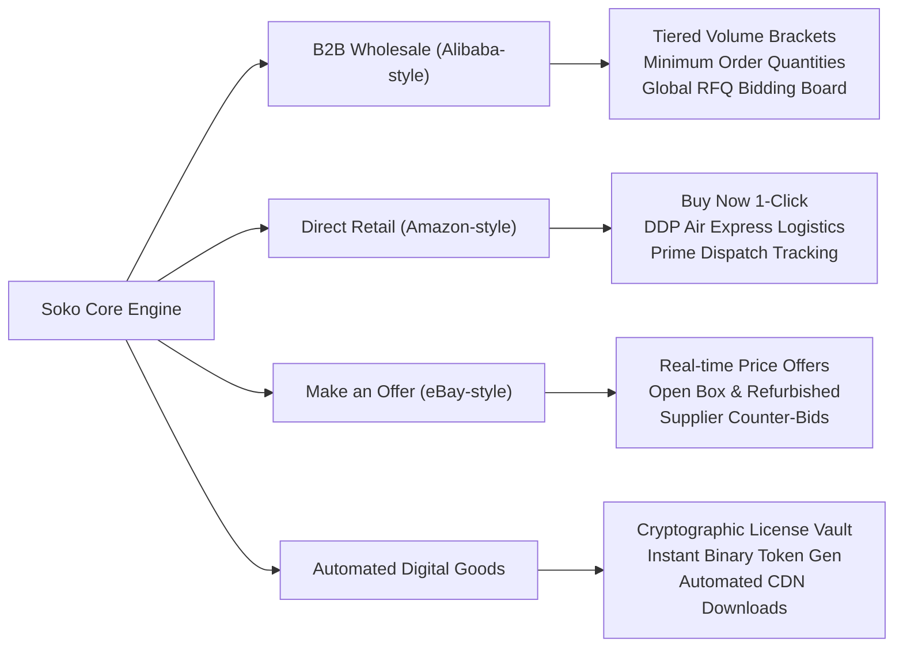

# Soko (ソコ) — Next-Gen Multi-Region Hybrid Commerce Platform

<div align="center">

```
  ███████╗ ██████╗ ██╗  ██╗ ██████╗ 
  ██╔════╝██╔═══██╗██║ ██╔╝██╔═══██╗
  ███████╗██║   ██║█████╔╝ ██║   ██║
  ╚════██║██║   ██║██╔═██╗ ██║   ██║
  ███████║╚██████╔╝██║  ██╗╚██████╔╝
  ╚══════╝ ╚═════╝ ╚═╝  ╚═╝ ╚═════╝ 
```

**Enterprise-Grade Multi-Region Commerce Engine**  
*Unifying the best of **Alibaba** (Wholesale B2B & RFQs), **Amazon** (High-Velocity Retail), **eBay** (Make an Offer & Secondary Condition Brackets), and **Digital Asset Delivery** (Cryptographic License Tokens & Secure Vault Downloads).*

[](https://www.goravel.dev)
[](https://inertiajs.com)
[](https://tailwindcss.com)
[](https://github.com/goravel/sqlite)
[]()

</div>

---

## 🌟 Executive Summary

**Soko** is engineered to eliminate the boundaries between B2B industrial procurement, direct-to-consumer retail, open peer-to-peer price negotiation, and automated digital goods licensing. Built on the high-performance **Goravel Framework** (Go) with **Inertia.js (Vue 3)** and **Tailwind CSS v4**, Soko provides a unified marketplace tailored to any regional market or trade corridor worldwide.

### Four Integrated Commerce Formats



1. **Alibaba Format (`wholesale`)**: Minimum Order Quantities (MOQ), tiered volume discount brackets (e.g., 1-4 units, 5-19 units, 20+ units), custom RFQs, and up to $1,000,000 Trade Assurance escrow protection.
2. **Amazon Format (`retail`)**: High-conversion instant checkout, verified supplier ratings, guaranteed 2-day delivery routes, and transparent tax and shipping breakdowns.
3. **eBay Format (`make_offer`)**: Buyer price proposals, supplier counter-offers, and secondary condition grading (`new`, `refurbished`, `open_box`).
4. **Digital Asset Vault (`digital`)**: Instant cryptographic software license generation (`SOKO-XXXX-YYYY`), perpetual licenses for cloud software, CAD blueprints, and pre-quantized machine learning weights.

---

## 🌍 Regional Market & Multi-Currency Engine

Soko features native multi-currency clearing and localized trade corridor settlement across **10 global currencies** and **7 regional hubs**:

| Region Code | Regional Hub | Default Currency | Flag | Supported Local Rails |
|:---|:---|:---|:---:|:---|
| `global` | Universal Unified Marketplace | **USD** ($) | 🌐 | Trade Assurance Escrow, Swift Wire, USDC/USDT |
| `east-africa` | East Africa (EAC Corridor) | **KES** (KSh) | 🇰🇪 | M-Pesa B2B Paybill, EAC Regional RTGS, Bank Wire |
| `west-africa` | West Africa (ECOWAS Hub) | **NGN** (₦) | 🇳🇬 | NIBSS Instant Payment, Flutterwave Escrow, Wire |
| `north-america`| North America (US & Canada) | **USD** ($) | 🇺🇸 | Fedwire, ACH Business Transfer, Trade Credit Line |
| `europe` | European Union & UK | **EUR** (€) | 🇪🇺 | SEPA Instant Credit Transfer, BACS UK, Corporate Card |
| `asia-pacific` | Asia-Pacific (Shenzhen & HK Hub) | **CNY** (¥) | 🇨🇳 | CIPS Cross-Border RMB, Alipay+ Merchant, T/T |
| `middle-east` | Middle East (GCC Hub) | **AED** (AED)| 🇦🇪 | UAE Central Bank Aani, SARIE, Trade Escrow |

---

## 🏗️ Clean Enterprise Architecture

Soko strictly separates business domains, validation, persistence, and presentation:

```
app/
├── http/
│   ├── requests/      # Goravel Form Requests (Validation rules & error messages)
│   │   ├── create_product_request.go
│   │   ├── checkout_request.go
│   │   ├── create_rfq_request.go
│   │   ├── submit_rfq_quote_request.go
│   │   ├── submit_offer_request.go
│   │   ├── login_request.go
│   │   └── register_request.go
│   ├── controllers/   # Ultra-thin presentation handlers
│   │   ├── store_controller.go     (Catalog, Detail, Checkout, Offers, RFQs)
│   │   ├── dashboard_controller.go (KPIs, Catalog CRUD, Quotations)
│   │   └── auth_controller.go      (Authentication, Registration, Sessions)
│   └── middleware/    # Auth and Inertia share props pipeline
├── models/            # Goravel/GORM database models with JSON serialization
│   ├── product.go     (Formats, conditions, price tiers, JSON hydration)
│   ├── order.go       (Orders, OrderItems, digital fulfillment tokens)
│   ├── rfq.go         (Sourcing RFQs and supplier quotes)
│   ├── offer.go       (eBay-style buyer negotiations)
│   ├── user.go        (Admins, Merchants/Suppliers, Enterprise Buyers)
│   └── region.go      (Currencies and regional market definitions)
├── actions/           # Single-responsibility write operations & transactions
│   ├── create_product_action.go
│   ├── delete_product_action.go
│   ├── execute_checkout_action.go
│   ├── issue_digital_license_action.go
│   ├── create_rfq_action.go
│   ├── submit_rfq_quote_action.go
│   ├── submit_offer_action.go
│   ├── authenticate_user_action.go
│   └── register_user_action.go
├── queries/           # Read-only database operations & aggregations
│   ├── product_queries.go
│   ├── order_queries.go
│   ├── rfq_queries.go
│   ├── offer_queries.go
│   ├── user_queries.go
│   └── dashboard_queries.go
└── services/          # Real domain orchestration services
    ├── catalog_service.go
    ├── order_service.go
    ├── rfq_service.go
    ├── offer_service.go
    ├── auth_service.go
    ├── currency_service.go
    ├── trade_assurance_service.go
    ├── logistics_service.go
    └── dashboard_service.go
```

---

## 🚀 Quick Start Guide

### Prerequisites
- **Go 1.23+**
- **Node.js 18+ & npm**
- Pure Go SQLite driver is pre-bundled — **no CGO compiler or gcc required**.

### 1. Clone & Install Dependencies

```bash
git clone https://github.com/elcomware/soko.git
cd soko

# Install Go modules
go mod download

# Install Frontend dependencies
npm install
```

### 2. Environment Configuration

```bash
cp .env.example .env
```

Ensure `.env` contains:
```ini
APP_NAME=Soko
APP_ENV=local
APP_KEY=                    # Generate with: go run . artisan key:generate
APP_PORT=8000
APP_URL=http://localhost:8000

DB_CONNECTION=sqlite
DB_DATABASE=database/soko.sqlite
```

### 3. Database Migrations & Seeds

Run migrations and seed the enterprise dataset (Users, Products, RFQs, Offers):

```bash
# Run all SQLite migrations
go run . artisan migrate

# Seed realistic enterprise data
go run . artisan db:seed
```

Or run fresh:
```bash
go run . artisan migrate:fresh
go run . artisan db:seed
```

### 4. Build Frontend & Launch

```bash
# Build production frontend assets (Tailwind v4 + Vite)
npm run build

# Start the Soko HTTP server
go run .
```

Open your browser at **`http://localhost:8000`**.

---

## 🔑 Demo Credentials

| Role | Email | Password | Access Scope |
|:---|:---|:---|:---|
| **Platform Administrator** | `admin@soko.global` | `secret123` | Full executive dashboard, user management, global oversight |
| **Enterprise Supplier (East Africa)** | `supplier.ea@soko.global` | `secret123` | Product catalog CRUD, RFQ bidding board, offer reviews |
| **Merchant Supplier (Shenzhen)** | `merchant.cn@soko.global` | `secret123` | OEM export catalog, shipping configurations |
| **Enterprise Procurement Buyer** | `buyer@soko.global` | `secret123` | RFQ submissions, instant checkout, digital license vault |

---

## 🛠️ Artisan CLI Utilities

Soko comes with the full Goravel Artisan console:

```bash
go run . artisan list              # List all available artisan commands
go run . artisan db:show           # Display database connection and table sizes
go run . artisan migrate:status    # Check status of each migration
go run . artisan make:model <Name> # Scaffold a new domain model
go run . artisan make:request <Req># Scaffold a new Form Request
go run . artisan route:list        # Show all registered routes
```

---

## 📄 License

The Soko platform is open-source software licensed under the [MIT License](LICENSE).
